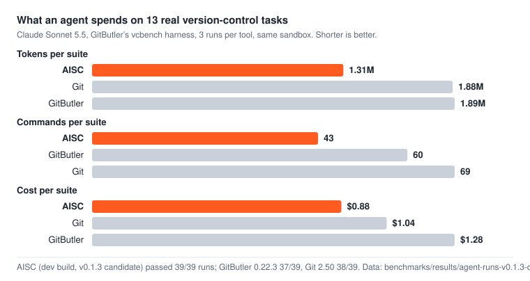

<div align="center">

<picture>
  <source media="(prefers-color-scheme: dark)" srcset="assets/logo-dark.svg">
  
</picture>

**Source control built for coding agents.**<br>
One command per history edit, output sized for a context window, every change undoable, Git underneath.

[](https://github.com/sagltd/aisc/releases/latest)
[](https://github.com/sagltd/aisc/actions/workflows/ci.yml)
[](LICENSE)
[](#safety)

[Install](#install) · [Benchmarks](#benchmarks) · [Commands](#commands) · [Safety](#safety) · [Disk](#disk) · [Agent skill](#agent-skill)

</div>

<br>

<picture>
  <source media="(prefers-color-scheme: dark)" srcset="assets/bench/agents-dark.svg">
  
</picture>

These are the 13 tasks AISC was tuned on. On **held-out tasks** it had never seen, the picture is mixed: GitButler won the first six (AISC 0.1.1 had no reword, drop or move-to-branch command), and the second six were a tie at the suite level, with AISC ahead on five tasks and far behind on one (amending into a commit on another branch, fixed since), and AISC won the third six outright: 13 tool calls and 0.47M tokens per suite against 20 and 0.64M for GitButler and 20 and 0.58M for Git ([held-out results](#held-out-tasks)). Every prompt, setup, script and per-run command is in [`benchmarks/agents`](benchmarks/agents).

## Install

```sh
# macOS on Apple Silicon. Intel macOS and Linux (x86_64, arm64) builds are on the Releases page.
curl -fsSL https://github.com/sagltd/aisc/releases/download/v0.1.1/aisc-v0.1.1-aarch64-apple-darwin.tar.gz | tar -xz
mkdir -p ~/.local/bin && mv aisc-v0.1.1-aarch64-apple-darwin/aisc ~/.local/bin/

# Or build from source (Rust 1.91+)
cargo install --git https://github.com/sagltd/aisc --locked
```

Then give your agent the workflow:

```sh
npx skills add sagltd/aisc --skill aisc     # the aisc skill
aisc agent setup --print >> AGENTS.md       # or CLAUDE.md
```

The agent runs `aisc log` to see ids and state, makes one call per edit, and can reverse anything with `aisc undo`.

## Command benchmark at a glance

Thirteen scripted version-control tasks, all four tools in the same run, every end state verified ([method](#command-benchmark)):

| | **AISC** | GitButler | Git | Jujutsu |
| --- | ---: | ---: | ---: | ---: |
| Commands an agent runs | **15** | 28 | 34 | 25 |
| Output the agent reads | **2.3 KB** | 7.1 KB | 4.4 KB | 4.4 KB |
| Transcript tokens (estimate) | **976** | 2,450 | 2,035 | 1,900 |
| Wall time, all thirteen tasks | **838 ms** | 1,580 ms | 1,053 ms | 1,467 ms |
| Agent guidance loaded per session | **664 tokens** | 5,890 tokens | — | 2,758 tokens |

Default output, no quiet flags. Tokens here are an offline `tiktoken` estimate of what the agent reads and types, not billed usage. Numbers are from one machine; run [`benchmarks/commands`](benchmarks/commands) to reproduce them on yours.

## Why AISC

- **One call per history edit.** Commit some hunks, amend a fix into an older commit, split, squash, reorder, sync, or branch off in place. Each is a single command instead of a stash-rebase-fixup script.
- **Output sized for a context window.** Short ids, one line per commit and per hunk, and only the lines an agent needs to chain its next command.
- **Every change is undoable.** Each write is one atomic ref transaction, recorded in an operation log. `aisc undo` reverses it, and `aisc undo` again redoes it.
- **Lean on disk.** Work happens in place by default. Worktrees are opt-in, can be sparse, and are removed when the task finishes.
- **Plain Git underneath.** Your repository stays an ordinary Git repository. Git is the storage and the transport, and nothing else needs a server or a daemon.

## Before / after

Fold three uncommitted fixes into the three commits they belong to:

<table>
<tr><th>Git</th><th>AISC</th></tr>
<tr><td>

```sh
git log --oneline -n 4
git add -p a.txt && git commit --fixup 77e7
git add -p b.txt && git commit --fixup f578
git add -p c.txt && git commit --fixup 475a
git stash
GIT_SEQUENCE_EDITOR=: git rebase -i \
  --autosquash HEAD~7
git stash pop
```

</td><td>

```sh
aisc log
aisc amend --into "add a" jji \
           --into "add b" min \
           --into "add c" qqu
```

</td></tr>
</table>

Real output:

```text
$ aisc log
main: last 4 commits (newest first)
0e26 add docs | docs/guide.md
475a add c | c.txt
f578 add b | b.txt
77e7 add a | a.txt
uncommitted:
a.txt jji @3 +1-1 EDIT3
b.txt min @3 +1-1 EDIT3
c.txt qqu @3 +1-1 EDIT3
docs/guide.md kio @1 +1-1 guide v2

$ aisc amend --into "add a" jji --into "add b" min --into "add c" qqu
amended 77e7 +1 hunk, f578 +1, 475a +1; rewrote 4; op 8324
main 0e260b3→af43f43 add docs
main: last 4 commits
a845 add c
2f4a add b
b492 add a
uncommitted: docs/guide.md

$ aisc commit -b docs --onto main -m "update guide" docs/guide.md
new branch docs: dedf "update guide"

$ aisc undo
undid commit 7d86
docs deleted
```

## Commands

A selector picks changes: a hunk id from `aisc log` (`jji`), a path, `PATH:12-30` (new-side lines) or `"PATH~text"` (the hunk containing *text*). A commit is a hex id or its exact subject.

| Command | What it does |
| --- | --- |
| `aisc log` | Branch view plus every uncommitted hunk with an id |
| `aisc show REV` | The hunks of a commit, a range, or the worktree; `REV:PATH` prints a whole file at that commit |
| `aisc branches [COMMIT]` | Local branches, or those whose history contains COMMIT |
| `aisc commit -m MSG SEL…` | Commit only the selected changes (`--all` for everything) |
| `aisc commit -b NEW --onto BASE -m MSG SEL…` | Put the selected changes on a new branch off BASE, without leaving your branch |
| `aisc amend --into COMMIT SEL…` | Fold changes into older commits (repeat `--into`) |
| `aisc split COMMIT --into MSG SEL…` | Break one commit into several |
| `aisc uncommit COMMIT SEL…` | Take changes out of a commit, keep them on disk |
| `aisc squash --into MSG COMMIT…` | Join commits |
| `aisc move COMMIT… --before\|--after COMMIT` | Reorder commits |
| `aisc move COMMIT… --to BRANCH` | Move commits to another branch |
| `aisc reword COMMIT -m MSG` | Change a commit's message |
| `aisc drop COMMIT…` | Remove commits and their changes |
| `aisc pick COMMIT… [-b NEW --onto BASE]` | Copy commits onto another branch |
| `aisc sync [ONTO] [--fetch]` | Rebase onto the base, carrying your uncommitted work; pauses on conflict |
| `aisc land BRANCH… --into main [--delete]` | Integrate finished branches, optionally deleting them |
| `aisc switch [-c] BRANCH` | Change branch, carrying uncommitted edits |
| `aisc discard SEL…` | Throw away selected changes (undoable) |
| `aisc undo` · `aisc oplog` | Reverse the last operation · list operations |
| `aisc start` · `verify` · `finish` · `gc` | Task lifecycle for parallel agents ([details](skills/aisc/references/lifecycle.md)) |
| `aisc agent setup --print` | The version-control block for an agent's `AGENTS.md` or `CLAUDE.md` |

Every write prints its result, so there is no need to re-check. `-q` prints a single line, `--json` prints machine output, and `aisc <command> --help` is the reference for the version you have installed.

## Benchmarks

### Real agents

Claude Sonnet 5.5 did the 13 tasks of GitButler's [vcbench](https://vcbench.dev) harness three times with each tool, in rotating order. Every arm got the same prompt, the same sandbox (accept-edits with an allowlist, no bypass) and its tool's own agent setup block (`aisc agent setup --print`, `but agent setup --print`, plain-Git instructions). The harness's own verifier grades each run, and a run also fails if the agent used a command the arm's policy blocks.

| 13 tasks × 3 runs, Claude CLI 2.1.310 | Passed | Tool calls per suite | Tokens per suite | Cost per suite | Time per suite |
| --- | ---: | ---: | ---: | ---: | ---: |
| **AISC dev (v0.1.3 candidate)** | **39/39** | **43** (41–44) | **1.31M** (1.29–1.34M) | **$0.88** ($0.88–0.89) | **206 s** (166–230) |
| GitButler 0.22.3 | 37/39 | 60 (57–62) | 1.89M (1.83–1.99M) | $1.28 ($1.26–1.31) | 241 s (210–287) |
| Git 2.50 | 38/39 | 69 (68–71) | 1.88M (1.81–1.95M) | $1.04 ($1.01–1.06) | 288 s (251–343) |

Means over the three runs, with the range in brackets, all on 2026-10-27 with the same Claude CLI. AISC passed every run and used 28% fewer tool calls, 31% fewer tokens, 31% less money and 14% less time than GitButler; against Git it used 38% fewer calls and 30% fewer tokens for 15% less money. GitButler's two misses and Git's one were a blocked raw Git write (`git rm --cached`, `git fetch`) and a wrong end state (multi-amend). Tokens and cost are what the Claude CLI reported, cache reads included; nearly all of them are the agent re-reading its own context once per tool call, so fewer calls is what saves tokens. A Claude CLI update between the earlier runs and these raised the fixed cost of every run by about 14k tokens, which is why the older table below is not comparable on tokens.

Per task, AISC is ahead or level on nine of the thirteen. It trails Git on the scoped review (5.3 calls to 4), the cold checkpoint (3 to 2, where no skill is installed), integrating topics (3.3 to 2: Git's agents just merge) and most of all on the selective copy, where the agent must run tests on the new branch (10.7 calls to Git's 3). That last one is the next thing to fix.

<details>
<summary>Earlier runs (Claude CLI 2.1.306, AISC v0.1.0 and v0.1.1)</summary>

| 13 tasks × 3 runs | Passed | Commands per suite | Tokens per suite | Cost per suite | Time per suite |
| --- | ---: | ---: | ---: | ---: | ---: |
| AISC v0.1.1 | 38/39 | 39 (39–40) | 0.98M (0.95–1.00M) | $0.61 ($0.60–0.61) | 218 s (187–239) |
| AISC v0.1.0 | 35/39 | 41 (38–45) | 1.02M (0.97–1.09M) | $0.61 ($0.60–0.62) | 242 s (207–277) |
| GitButler 0.22.3 | 38/39 | 61 (56–65) | 1.62M (1.52–1.77M) | $0.99 ($0.94–1.07) | 310 s (238–413) |
| Git 2.50 | 38/39 | 63 (61–65) | 1.43M (1.42–1.44M) | $0.73 ($0.72–0.73) | 335 s (312–369) |

The four failed v0.1.0 runs had a correct end state but used a raw Git write the AISC arm blocks (`git branch -D` after landing, `git worktree add` to run tests); v0.1.1 added `aisc land --delete` and the `aisc switch` advice. AISC's agent block and several commands were improved after watching its runs on these same 13 tasks, while GitButler and Git use their shipped setup; the held-out tasks below test that.

</details>

Everything needed to check or repeat these runs (task prompts, each tool's instructions, the run script, the export script and a script that recomputes this table) is in [`benchmarks/agents`](benchmarks/agents). Per-run metrics, including every version-control command each agent ran, are in [`agent-runs-v0.1.3-dev.json`](benchmarks/results/agent-runs-v0.1.3-dev.json) (all three tools, this table), [`agent-runs-v0.1.0.json`](benchmarks/results/agent-runs-v0.1.0.json) and [`agent-runs-v0.1.1.json`](benchmarks/results/agent-runs-v0.1.1.json).

### Held-out tasks

Six more tasks, written after the runs above and [committed before any agent ran them](benchmarks/agents/heldout/tasks.md), so AISC could not be tuned for them. They cover rewording an older commit's message, dropping a commit, two commits by topic, moving a commit to another branch, finding which commit set a value, and committing onto another branch. Same agent, settings and grading as above, 3 runs per tool.

| 6 tasks × 3 runs, per suite | Passed | Commands | Tokens | Cost | Time |
| --- | ---: | ---: | ---: | ---: | ---: |
| AISC v0.1.1 | 18/18 | 24 (21–26) | 0.62M (0.55–0.67M) | $0.31 | 96 s |
| **GitButler 0.22.3** | **18/18** | **15** (13–16) | **0.42M** (0.38–0.44M) | **$0.27** | **66 s** |
| Git 2.50 | 15/18 | 21 (14–31) | 0.51M (0.37–0.72M) | $0.28 | 85 s |
| AISC v0.1.2 dev, re-run after the fixes (tasks known by then) | 18/18 | 8 (8–9) | 0.35M (0.34–0.36M) | $0.35 | 60 s |

GitButler wins this set. Per task:
- **Reword (11 vs 2 commands).** AISC has no command that edits a commit message. Its agent got there by uncommitting, recommitting and moving the change.
- **Move a commit to another branch (4 vs 3).** It took `pick`, `uncommit` and `discard`.
- **The other four tasks** were close. AISC was ahead on two commits by topic (2 vs 3) and slightly behind on finding the commit (1.7 vs 1). Dropping a commit and committing elsewhere were level.
- **Git** failed all three runs of committing onto another branch, because the edit stayed on disk.

v0.1.2 adds the missing commands (`aisc reword`, `aisc drop`, `aisc move --to`). Re-run with them (last row; AISC only, and the tasks were no longer held out), the suite took 8 tool calls instead of 24 and 0.35M tokens instead of 0.62M, below GitButler's 15 and 0.42M, with every task at one call except two commits by topic (2) and committing elsewhere (2.3: agents first wrote a directory selector or `-b hotfix --onto hotfix`, both of which the next version accepts). Per-run data: [`agent-runs-heldout-v0.1.1.json`](benchmarks/results/agent-runs-heldout-v0.1.1.json), [`agent-runs-heldout-v0.1.2-after.json`](benchmarks/results/agent-runs-heldout-v0.1.2-after.json).

#### Held-out set 2 (v0.1.2)

Six new tasks, [written after v0.1.2 and committed before any agent ran them](benchmarks/agents/heldout/tasks.md): amend a forgotten file into the newest commit and reword it, uncommit the newest commit keeping its changes, a stacked branch with one commit, amend into a commit on a branch that is not checked out, list the files a commit changed, and one commit here plus one on a new branch off `main` from a dirty work tree. Same agent, settings and grading; 3 runs per tool.

| 6 tasks × 3 runs, per suite | Passed | Tool calls | Tokens | Cost | Time |
| --- | ---: | ---: | ---: | ---: | ---: |
| AISC v0.1.2 | 17/18 | 18 (17–18) | 0.60M (0.58–0.61M) | $0.40 | 123 s |
| **GitButler 0.22.3** | **18/18** | 18 (17–19) | 0.59M (0.57–0.61M) | $0.40 | 117 s |
| Git 2.50 | 15/18 | 11 (10–12) | 0.39M (0.37–0.42M) | $0.34 | 85 s |

A tie overall, made of one bad task and five good ones. Per task (mean tool calls and tokens per run):
- **Amend into a commit on another branch: AISC 12 calls and 337k tokens, GitButler 3 and 98k, Git 4.7 and 135k.** AISC v0.1.2 refused `amend --into` for a commit that was not on the checked-out branch, and its agents spent ten or more calls trying `switch`, `commit --onto` and `squash`; one run failed. This is fixed after these runs: `aisc amend --into COMMIT SEL...` now finds the branch and amends there in one call.
- **The other five tasks: AISC 1–1.3 calls and 48–57k tokens each; GitButler 1.3–4 calls and 56–124k; Git 1–2 calls and 46–70k.** Git's agents batch several commands into one tool call, which keeps their token count low, but all three Git runs of the two-branches task left the docs file on disk and failed.
- Tokens per run are what the Claude CLI reported, cache reads included. A one-call task costs about 48k tokens for every tool: that is the prompt, the agent's instructions and the task, so the differences are all in the extra calls.

Re-run with the fix (AISC only; the tasks were known by then), the suite took **8 tool calls, 0.35M tokens and $0.35**, 18/18 passed, and the amend task went from 12 calls to 2 (`aisc log`, then `aisc amend`). One of those 18 runs first ended in a Claude CLI authentication error before any command ran and was repeated.

Per-run data: [`agent-runs-heldout2-v0.1.2.json`](benchmarks/results/agent-runs-heldout2-v0.1.2.json) and [`agent-runs-heldout2-v0.1.2-after.json`](benchmarks/results/agent-runs-heldout2-v0.1.2-after.json). The export script that produced them from the harness's run directories is [`benchmarks/agents/export.py`](benchmarks/agents/export.py).

#### Held-out set 3

Six more tasks, [written after all the fixes above and committed before any agent ran them](benchmarks/agents/heldout/tasks.md): commit one hunk plus a test and keep the other hunk, split a commit by directory, move two commits to a new branch off `main`, reorder a commit and fix its message, name the branches that contain a commit, and discard one hunk of a file. Same agent, settings and grading, same Claude CLI for every tool, 3 runs per tool.

| 6 tasks × 3 runs, per suite | Passed | Tool calls | Tokens | Cost | Time |
| --- | ---: | ---: | ---: | ---: | ---: |
| **AISC dev (v0.1.3 candidate)** | **18/18** | **13** (12–15) | **0.47M** (0.44–0.51M) | **$0.37** | **85 s** |
| GitButler 0.22.3 | 18/18 | 20 (18–24) | 0.64M (0.59–0.72M) | $0.42 | 98 s |
| Git 2.50 | 18/18 | 20 (18–21) | 0.58M (0.54–0.61M) | $0.38 | 111 s |
| AISC dev, re-run after `move --to NEW --onto BASE` and `aisc branches` (tasks known by then) | 18/18 | 10 (9–11) | 0.38M (0.36–0.41M) | $0.35 | 99 s |

AISC wins this unseen set: 35% fewer tool calls than either tool, 27% fewer tokens than GitButler and 19% fewer than Git. Per task it is ahead or level on five of the six (one `aisc log` plus one verb, or a single call for the reorder-and-reword pair); it trailed Git on naming the branches that contain a commit (3.7 calls to 3), where it had no verb of its own and agents fell back to read-only `git branch --contains`, and moving two commits to a new branch took `pick` plus `drop` (2.3 calls). Both have a verb since (`aisc branches COMMIT`, `aisc move --to NEW --onto BASE`); the re-run with them (last row) took 10 tool calls and 0.38M tokens per suite, with those tasks at 1.7 and 1 calls.

Per-run data: [`agent-runs-heldout3-v0.1.3-dev.json`](benchmarks/results/agent-runs-heldout3-v0.1.3-dev.json) and [`agent-runs-heldout3-v0.1.3-dev-after.json`](benchmarks/results/agent-runs-heldout3-v0.1.3-dev-after.json).

### Command benchmark

[`benchmarks/commands`](benchmarks/commands) runs thirteen tasks modelled on [vcbench](https://vcbench.dev) and the held-out sets: select hunks, amend an older commit, split, reorder, squash, uncommit, undo a rewrite, sync with a conflict, branch off in parallel, inspect state, reword a commit, drop a commit, and move a commit to another branch. Each tool runs the shortest correct sequence an expert would type, every end state is graded the same way, and the tools run in alternating order on the same fixtures. The run below measured a release build of `dev` at 7011e25 (v0.1.2 plus `show COMMIT:PATH` and the cross-branch amend) with 6 repetitions plus a warm-up, on an 11-core laptop whose one-minute load average fell from 35 to 9 during the run; results are in [`benchmarks/results/commands-v4.json`](benchmarks/results/commands-v4.json) (the earlier ten-task runs are `commands-v2.json` and `commands-v3.json`).

Each cell is commands · output bytes · median wall time (default output, Apple Git 2.50.1, GitButler 0.22.3, Jujutsu 0.42.0, macOS arm64):

| Task | **AISC** | GitButler | Git | Jujutsu |
| --- | ---: | ---: | ---: | ---: |
| Commit selected hunks | **1 · 170 B · 78 ms** | 2 · 1,801 B · 93 ms | 3 · 904 B · 67 ms | 5 · 494 B · 158 ms |
| Amend fixes into older commits | **1 · 141 B · 87 ms** | 2 · 379 B · 83 ms | 2 · 212 B · 91 ms | 1 · 156 B · 93 ms |
| Split a commit | **1 · 172 B · 42 ms** | 4 · 937 B · 201 ms | 5 · 451 B · 110 ms | 2 · 428 B · 137 ms |
| Reorder commits | **1 · 216 B · 37 ms** | 2 · 319 B · 76 ms | 1 · 98 B · 44 ms | 2 · 251 B · 89 ms |
| Squash commits | **1 · 179 B · 34 ms** | 2 · 317 B · 78 ms | 1 · 293 B · 68 ms | 1 · 164 B · 60 ms |
| Uncommit a file | **1 · 153 B · 81 ms** | 2 · 380 B · 96 ms | 4 · 396 B · 85 ms | 1 · 128 B · 73 ms |
| Undo the last operation | **1 · 42 B · 24 ms** | 1 · 53 B · 43 ms | 2 · 272 B · 26 ms | 1 · 320 B · 32 ms |
| Sync a dirty branch, resolve a conflict | **3 · 481 B · 207 ms** | 4 · 1,294 B · 335 ms | 4 · 842 B · 146 ms | 4 · 1,077 B · 256 ms |
| Branch off in parallel | **1 · 37 B · 42 ms** | 1 · 71 B · 72 ms | 3 · 170 B · 54 ms | 2 · 357 B · 124 ms |
| Inspect status, log and diff | **1 · 246 B · 13 ms** | 2 · 385 B · 45 ms | 3 · 113 B · 37 ms | 2 · 357 B · 75 ms |
| Reword a commit | **1 · 164 B · 33 ms** | 2 · 406 B · 82 ms | 1 · 306 B · 97 ms | 1 · 156 B · 75 ms |
| Drop a commit | **1 · 130 B · 67 ms** | 2 · 418 B · 91 ms | 1 · 114 B · 57 ms | 1 · 297 B · 90 ms |
| Move a commit to another branch | **1 · 189 B · 89 ms** | 2 · 481 B · 78 ms | 4 · 340 B · 117 ms | 2 · 310 B · 134 ms |
| **Total** | **15 · 2.3 KB · 838 ms** | 28 · 7.1 KB · 1,580 ms | 34 · 4.4 KB · 1,053 ms | 25 · 4.4 KB · 1,467 ms |

Against GitButler, AISC uses fewer commands and less output on every task (undo and the parallel branch tie at one command) and less time on all but two, where GitButler is a few milliseconds faster (amend, move to another branch). Against the others, it is not best on every cell:
- **Jujutsu** is faster on uncommit and prints slightly less on uncommit, squash and reword. With `--quiet` it prints nothing on success, so in quiet mode it reads fewer bytes than AISC's one-line `-q` results.
- **Git** is faster at syncing with a conflict and at dropping a commit, and prints less when reordering, dropping or inspecting, because a bare `git log --oneline` says less than AISC's hunk listing.
- **Scope.** These are scripted sequences, not live agents. They count the commands and text an agent would handle, but not model reasoning. Real-agent runs on vcbench are the next step.

### Agent guidance

The skill an agent loads every session costs context too ([`benchmarks/README.md`](benchmarks/README.md#context-cost-agent-guidance)):

| Guidance | Loaded every session | On demand |
| --- | ---: | ---: |
| **AISC** skill | **664 tokens** | 681 |
| GitButler 0.22.3 (setup + skill) | 5,890 tokens | 14,487 |

### vcbench reference solutions

With no model in the loop, the reference solutions for the 13 vcbench tasks need **1.08 AISC calls and 296 bytes** of output per task (14 calls, 3.8 KB in all, re-measured with the current dev build), against 5.31 calls and 12.5 KB for GitButler and 6.15 calls and 639 bytes for Git. All of them pass the harness's own verification; the twelve held-out tasks have references too (13 calls in all). AISC's arm for the GitButler harness lives in [`benchmarks/vcbench`](benchmarks/vcbench).

## Disk

Four agents on a 5,000-file, 78 MiB repository ([`benchmarks/disk.py`](benchmarks/disk.py)):

| Setup | Disk added |
| --- | ---: |
| **AISC in place** (default, one shared checkout) | **0.12 MiB** |
| GitButler virtual branches (one shared checkout) | 0.50 MiB |
| **AISC after `finish`** (worktrees removed) | **0.11 MiB** |
| **`aisc start --path --sparse src`** | **48.9 MiB** |
| `git worktree add` / `aisc start --path` | 236 MiB |
| `jj workspace add` | 236 MiB |

- `aisc finish` removes the worktree it created. `--keep` keeps it.
- `aisc gc` lists leftover AISC worktrees and the space they hold. `aisc gc --apply` removes them.
- Removal deletes only content known to be regenerable (`target`, `node_modules`, `.venv`, build output). A worktree holding anything else, such as secrets, nested repositories or unknown ignored files, is kept and reported.
- AISC never touches worktrees it did not create, and before cleanup it saves any commit that would otherwise become unreachable under `refs/aisc/rescue/`.

## Safety


- **All or nothing.** Refs move in one compare-and-swap transaction. If anything changed underneath, the command exits with code 4 and changes nothing.
- **Crash-safe.** A journal lets the next command finish or roll back an operation that was killed at any step.
- **Your edits win.** A file edited while AISC is working is never overwritten. The edit is kept beside the file as `PATH.aisc-conflict` and reported.
- **Your index is yours.** Staged changes you did not select stay staged, including partial `git add -p` stages and `git add -N` placeholders.
- **Verified rewrites.** After an amend, split or uncommit, every rewritten commit is checked line by line against its own original diff. If the placement is ambiguous, the command refuses rather than guesses.
- **Hooks.** `checkpoint` runs your Git hooks. History plumbing commits do not, as with `git rebase`.
- **Requirements.** Git 2.43+ (SHA-1 and SHA-256 repositories), macOS or Linux. CI runs on Ubuntu 24.04 and macOS 15.

## Agent skill

[`skills/aisc/SKILL.md`](skills/aisc/SKILL.md) is a 664-token decision table: one command per task, the selectors, and the rules an agent needs (exit codes, refusals, undo). Parallel-agent lifecycle, pull requests and sandbox notes live in [`references/lifecycle.md`](skills/aisc/references/lifecycle.md), which agents load only when they need it.

<details><summary>Sandboxed agents (Codex, Claude)</summary>

AISC writes Git metadata, so the agent's sandbox must allow the repository's `.git` directory. For non-interactive Codex, pass `--add-dir /abs/path/to/repo/.git`. For a linked worktree, allow both directories:

```sh
git rev-parse --path-format=absolute --git-dir --git-common-dir
```

Do not disable the sandbox.

</details>

<details><summary>Output formats</summary>

History commands print compact text. `-q` prints a single line, `--json` or `AISC_OUTPUT=json` prints stable JSON, and `--human --color always|never` controls colour. `NO_COLOR` is honoured. Errors carry a code: `usage`, `selector`, `stale`, `dirty`, `conflict`, `unsupported`, `state` or `git`. Exit codes: 0 success (a paused sync included), 1 refused or failed with nothing changed, 2 usage, 4 stale (something changed concurrently; nothing changed, run `aisc log` and retry).

</details>

## Project

[Contributing](CONTRIBUTING.md) · [Security](SECURITY.md) · [Changelog](CHANGELOG.md) · [Design](docs/design/history.md) · [MIT License](LICENSE)

Features land in `dev` by pull request, and releases reach the protected `main` branch by pull request from `dev`. The benchmark harness builds on [vcbench](https://vcbench.dev), an MIT-licensed project by GitButler. Competitor numbers come from running their released tools on the same machine.
